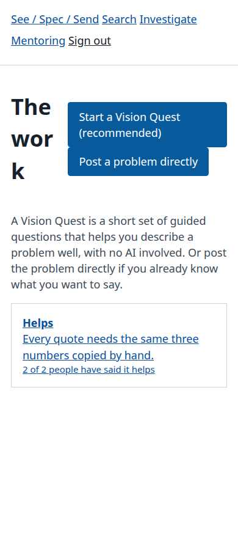
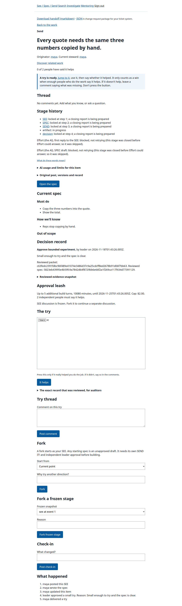

# See / Spec / Send

[](https://github.com/stevenammer/see-spec-send/actions/workflows/ci.yml) [](https://github.com/stevenammer/see-spec-send/actions/workflows/codeql.yml) [](SECURITY.md)

Everybody at work already knows the thing that's broken. The workaround has a name. Somebody has a spreadsheet for it. And nobody fixes it, because the people who feel it don't get to build anything, and the people who build things never feel it.

This is my attempt at a free, open-source way for any organization to fix that with AI, and to do it the right way:

1. **See it.** Find the problem everyone already knows about and nobody has fixed. Check first whether something you already have solves it (a setting, a tool you pay for, a free one). Plenty of problems end right there.
2. **Spec it.** Write down exactly what the fix has to do, and how we'll know it worked.
3. **Send it.** A leader sets a budget. An agent builds a small version. It goes in front of the people doing the work, and **nothing counts until they say it helps.**

That last rule isn't a policy in a handbook. The code enforces it. There's no "done" button anywhere. An item only reaches Helps when enough different people, who are neither the one who wrote the spec nor the one who approved it, confirm the current build helps. A leader can't override it. You can [watch the real server refuse](docs/WATCH_IT_REFUSE.md) the person who wrote the spec, the leader who approved it, and a made-up "done" event.

**Try the demo.** It runs in your browser at https://stevenammer.github.io/see-spec-send/. The people are invented, there's no server, and nothing leaves your page. It runs a copy of the real state machine, so you can try to get around the rule and watch it refuse. It doesn't have sign-in, the database, or the password step-up. More in [docs/DEMO.md](docs/DEMO.md).

## Is it ready for a business?

Not yet, and I'd rather say so up front. It's early, and I'm building it in public. Here's the split.

**What's solid (and you can check it):**

- The core rules are tested, including the refusals. Over 700 tests run on every push, plus real-browser walkthroughs in Chrome and an accessibility audit.
- I break the controls on purpose to see if the tests notice (about 500 deliberate breaks so far). If a test can't fail, I don't count it. Right now I run that check by hand. It isn't in CI yet, and I want it there.
- Models can draft and explain, but they can't approve, spend or decide. Spending is metered and capped. A set of 60 hostile strings (fake instructions, look-alike characters, hidden script, fake tool calls) goes through every place a model sees text, and a real Chrome test checks that each one shows up as plain text and never runs.
- People only see what their department's scope lets them see, across pages, search, exports and what gets sent to a model.
- Builds run in a locked container with no network. The only way out is a socket to the gateway that holds the key and counts the money.
- Sign-in works with any standard OIDC provider, tested against an independent one. If the server dies, you can bring it back from a copy that follows the database about once a second (Litestream, optional). In my drill it was back in under a second and lost the last couple of seconds of writes. The [HA doc](docs/HA.md) says plainly what that does and doesn't give you, including that a person still makes the call.
- CodeQL runs on every push, and two rounds of software security review found real problems. All of them are fixed, and each fix has a test that fails without it.

**What isn't done (and no amount of code finishes it):**

- No outside penetration test. No SOC 2. No human screen-reader test.
- No test against a real Okta, Entra or Google tenant yet.
- No automatic failover and no Postgres. It's SQLite with a live copy, and a person decides when to switch. There's a seam for Postgres and nothing behind it.
- No Teams or Microsoft 365 integration. That's planned, and not shipped.
- No real pilot with real employees. That's the one that matters most.

The full table is [docs/STATUS.md](docs/STATUS.md). The long version of what's built is [docs/WHAT_IS_BUILT.md](docs/WHAT_IS_BUILT.md).

## Security and trust

Written down so you can check it instead of taking my word. There are no runtime dependencies. Start with [SECURITY.md](SECURITY.md) (how to report a problem), then the [threat model](docs/THREAT_MODEL.md), [what's being watched right now](docs/SECURITY_WATCH.md), the [vendor questionnaire](docs/VENDOR_QUESTIONNAIRE.md) and the [pilot guide](docs/PILOT_GUIDE.md). There's also a generated [table of every route and how it's authenticated](docs/ROUTE_TABLE.md).

## Run it yourself

You need Node 22.19 or newer. There's nothing to install. This starts a server with a throwaway database:

```sh
export SSS_DB="$(mktemp -d)/sss.db"
node cli.js init --id leader
node cli.js serve --port 8787 --insecure-cookies
```

`init` prints a temporary leader password. Copy it, open http://127.0.0.1:8787/signin, sign in as `leader`, and pick a real password before you do anything else. `--insecure-cookies` is for local http only. Delete the temp folder and everything's gone. To see the main rule refused without clicking through it, run `node scripts/watch-it-refuse.mjs`.

The checks:

```sh
npm test               # the whole suite
npm run check:mutants  # break controls on purpose (slow, hours)
npm run check:public   # scans files and git history for secrets and private paths
npm run test:listen    # real server, short end-to-end
npm run test:container # needs Docker; uses a local mock model, never a real one
```

The browser tests (`npm run test:e2e`, `test:vision`, `test:hostile-render` and friends) need Playwright and Chrome. Set `PLAYWRIGHT_DIR` to the folder that holds Playwright.





(Fictional data, from the real-browser test.)

## How I'm building it

I write the specs and decide what's safe to ship. AI agents write most of the code. Then I try to break what comes back, and I keep every attack that found a real bug as a permanent test. So far that's a money rounding bug, a reused retry key that silently dropped an event, a stale builder that could deliver under a newer approval, and a same-origin check that a lookalike address could fool. A second AI, set loose as a hostile reviewer, found four more: world-readable database files, a verifier that said "ok" to forged metadata, a lockout that let a stranger lock you out, and a rate limiter that never forgot.

I've called a real free-tier model by hand once. No paid hosted model has been called in any test.

## Where it's headed

The forum comes first, as the whole product. After that, the places people already work (Microsoft Teams first) get the same workflow with the same rules. Your data, your models and your coding agent should be your organization's choice, not mine. That's the goal, and not everything on that list is built. [docs/VISION.md](docs/VISION.md) has the long version, [docs/ROADMAP.md](docs/ROADMAP.md) has the order, and [docs/DECISIONS.md](docs/DECISIONS.md) has why I chose what I chose. The working umbrella name is E.F.F.O.R.T. for Organizations, and the name is provisional.

Credits and licenses for what this builds on are in [ACKNOWLEDGMENTS.md](ACKNOWLEDGMENTS.md).

## Contributing

Read-only for now. Issues and Discussions are open, and I'd love to hear what's wrong with the idea. I'm holding pull requests until the core settles, so nobody wastes effort on something that moves under them.

## License

Apache-2.0. Free for every organization.
