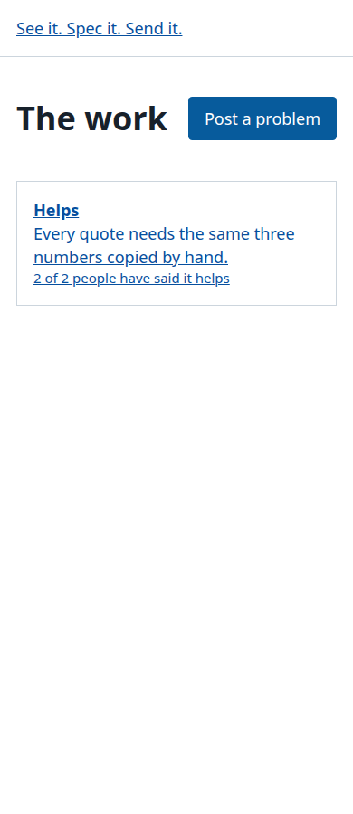
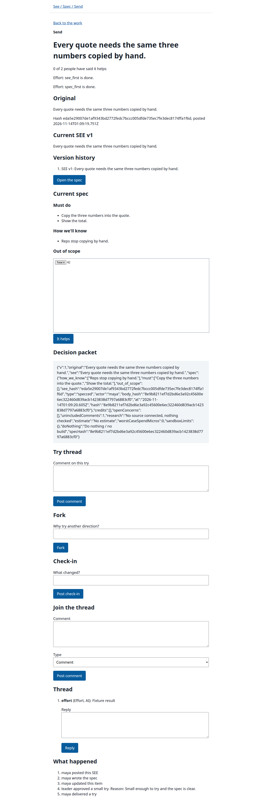

# See it. Spec it. Send it.

Everybody at work already knows the thing that's broken. The workaround has a name. Somebody has a spreadsheet for it. And nobody fixes it, because the people who feel it don't get to build anything, and the people who build things never feel it.

This is my attempt at a free, open-source way for any organization to fix that with AI, and to do it the right way:

1. **See it.** Find the problem everyone already knows about and nobody has fixed. Check first whether something you already have solves it (a setting, a tool you pay for, a free one). Plenty of problems end right there.
2. **Spec it.** Write down exactly what the fix has to do, and how we'll know it worked.
3. **Send it.** A leader sets a budget. An agent builds a small version. It goes in front of the people doing the work, and **nothing counts until they say it helps.**

That last rule isn't a policy in a handbook. The code enforces it. There's no "done" button anywhere. An item only reaches Helps when enough different people, who are neither the one who wrote the spec nor the one who approved it, confirm the current build helps. A leader can't override it. You can [watch the real server refuse](docs/WATCH_IT_REFUSE.md) the person who wrote the spec, the leader who approved it, and a made-up "done" event.

**Try the demo.** There's a small demo that runs in your browser, at https://stevenammer.github.io/see-spec-send/. The people are invented, there's no server, and nothing leaves your page. It runs a copy of the real state machine, so you can try to get around the rule and watch it refuse. It doesn't have sign-in, the database, or the password step-up. See [docs/DEMO.md](docs/DEMO.md).

## Where this actually is

I'm building this in public, and it's early. Here's the honest state:

- **Works and tested:**
  - **The core.** A small state machine that decides what can happen to an item, and a local store that records every step in a tamper-evident chain. Money is exact, builder events are tied to the approval they were built under, and each event hashes the authority it was accepted under. Registry edits cannot rewrite history. Exports include the registry, so importing is an administrator action for files you exported yourself.
  - **The manual path with a web UI.** A person can post a checked problem, write a spec, have a leader who isn't the steward approve it with a password step-up, deliver one safe playable try, and reach Helps only when other people say it helps.
  - **Vision Quest without a model.** A signed-in person can work through one question at a time, correct the playback, and end with a memo that recommends BUILD, CONFIGURE, BUY OR USE, PROCESS CHANGE or KILL. Posting makes one checked problem, and a build proposal opens the steward's spec form with a first draft. Draft answers survive a reload, corrections keep the originals, and earlier quests can be exported after starting another. Shared items keep the derived memo; raw conversation stays browser-side at rest. Posting is safe to retry. It makes no AI calls. See [docs/VISION_QUEST.md](docs/VISION_QUEST.md) for the exact boundaries.
  - **Sign-in and a small HTTP API.** Invites, passwords, sessions, CSRF protection, rate limits, and a leader step-up before anything gets approved. The command line is the only admin surface. See [docs/ADMIN.md](docs/ADMIN.md) and [docs/THREAT_MODEL.md](docs/THREAT_MODEL.md), which also lists what's not covered.
  - **The local worker and fake builder.** An approved spec can reach a small static try through one durable run. The worker recovers after a crash and can be stopped from the command line. Crash, race, stale-output, and adapter-contract tests cover that path. The fake uses no network, model, or money. See [docs/ADAPTER.md](docs/ADAPTER.md).
- **Not built yet:** the model layer, external builder adapters, the cost gateway, a process watchdog, the portable Vision Quest prompt, model-assisted Vision Quest, Vision Quest in the anonymous demo, and kept modules. Don't try to run an organization on this yet.

I'm treating tests as claims. `npm test` runs them, and `npm run check:mutants` deliberately breaks individual controls and checks that the tests notice. If a test can't fail, I don't count it.

## What it looks like





These screenshots come from the real-browser test.

## Run it yourself

You need Node 22.13 or newer. There's nothing to install. Start a server with a throwaway database:

```sh
export SSS_DB="$(mktemp -d)/sss.db"
node cli.js init --id leader
node cli.js serve --port 8787 --insecure-cookies
```

`init` prints a one-time password for the leader, so copy it. `serve` keeps running, so use a second terminal for anything else. Then open http://127.0.0.1:8787/signin and sign in as `leader`. `--insecure-cookies` is for local http only. The database is in a temp folder, and deleting that folder removes everything.

To see the main rule refused without clicking through it, run `node scripts/watch-it-refuse.mjs`. The output is in [docs/WATCH_IT_REFUSE.md](docs/WATCH_IT_REFUSE.md).

## Words used here

- **Steward:** the person who made the first `checked` event for an item. A leader can hand it to someone else.
- **Approver:** the person recorded on the `approved` event. It has to be a leader who isn't the steward.
- **Step-up:** typing your password again, right before approving. It's good for five minutes and works once.
- **Quorum:** how many different people must say "it helps". The approver sets it, and it's frozen with the approval.
- **Artifact:** the one playable HTML try that gets delivered. A "helps" only counts for the current artifact.

## Try it

These are the checks. There are no dependencies to install for the first four.

```sh
npm test
npm run check:mutants
npm run check:public
npm run test:listen
```

`test:listen` starts a real server on a local port and runs a short end-to-end check. `check:public` is a guard that scans the files and the git history for secrets, private paths, personal emails and backup files before anything gets published.

`npm run test:e2e` is separate and isn't part of the no-dependency path. It drives a real browser, so it needs an existing Playwright install (set `PLAYWRIGHT_DIR` to the folder that holds it) and Chrome (set `CHROME_PATH` if it isn't at `/usr/bin/google-chrome`).

## How I'm building it

I write the specs and decide what's safe to ship. AI agents write most of the code. Then I try to break what comes back, and I keep the attacks that found real bugs as permanent tests. So far, attacks found a money rounding bug, a reused retry key that silently dropped an event, a stale builder that could deliver under a newer approval, and a same-origin check that a lookalike address could fool. A second AI, set loose as a hostile reviewer, found four more: world-readable database files, a verifier that said "ok" to forged metadata, a lockout that let a stranger lock you out, and a rate limiter that never forgot. All of them are fixed, and each fix has a test that fails without it.

## Contributing

Read-only for now. Issues and Discussions are open, and I'd love to hear what's wrong with the idea. I'm holding pull requests until the core settles, so nobody wastes effort on something that moves under them.

## License

Apache-2.0. Free for every organization.
